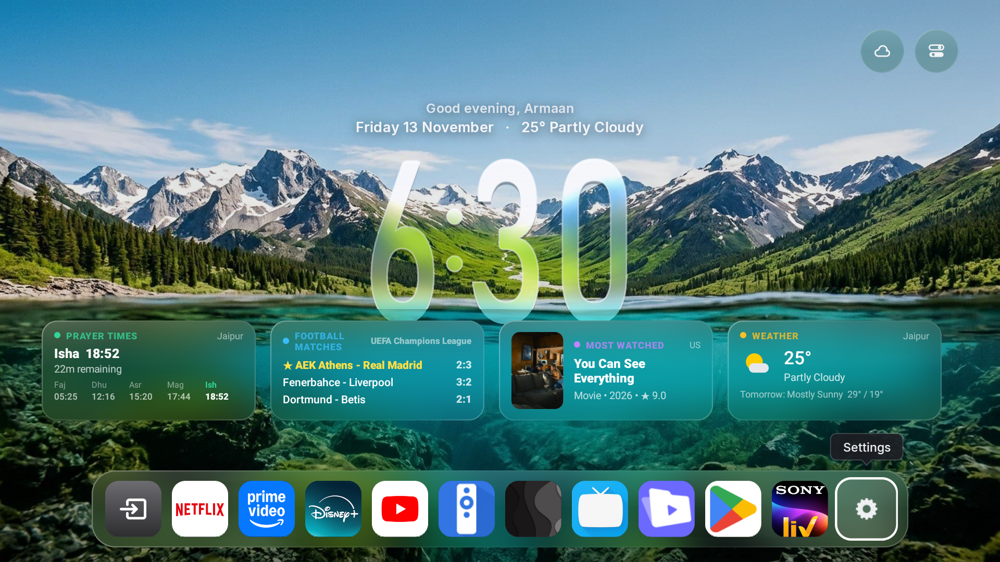
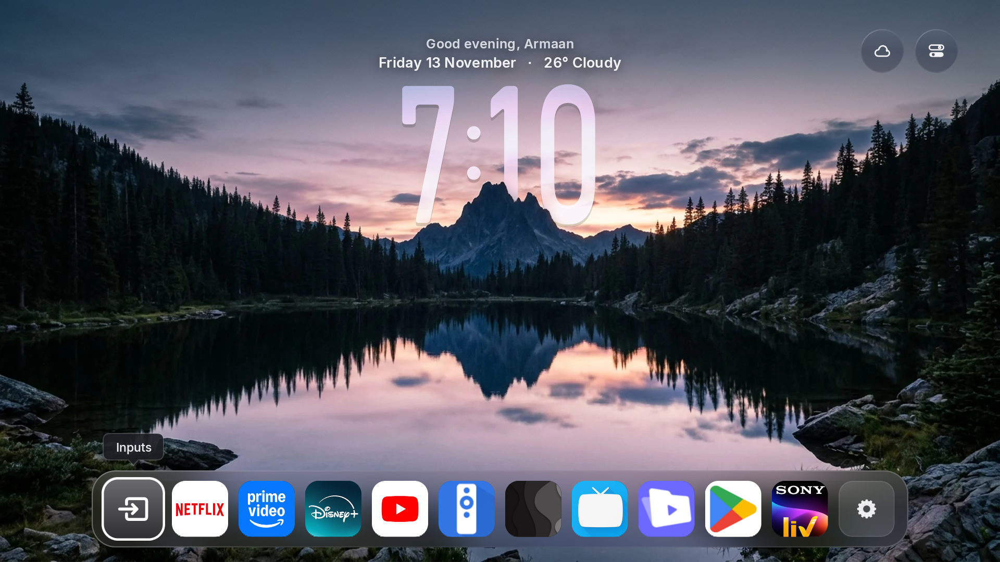
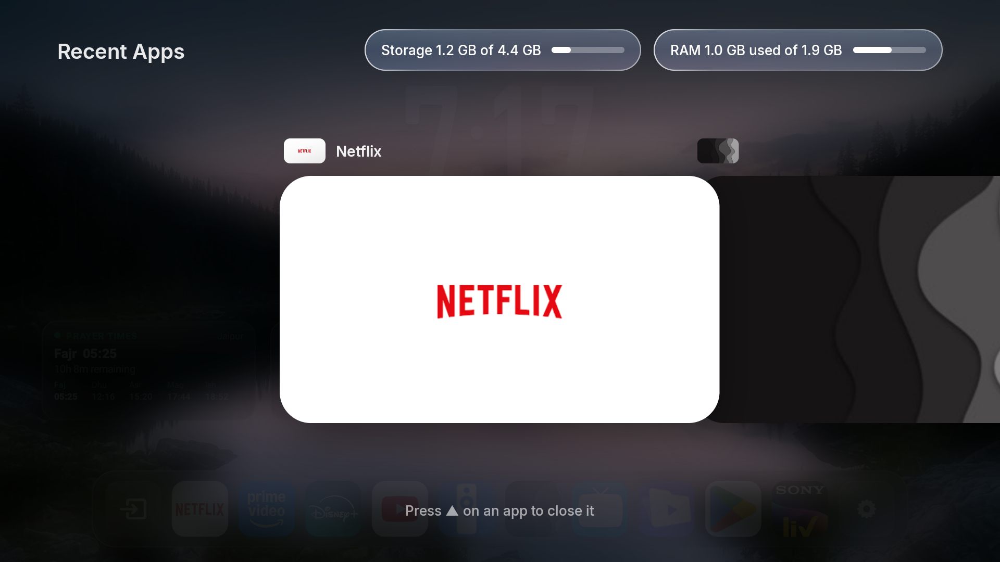
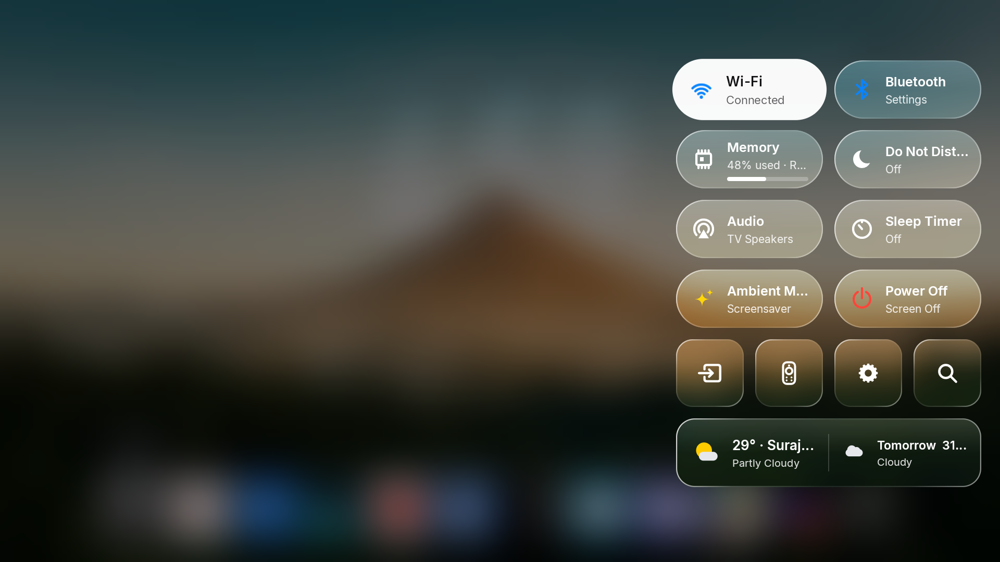
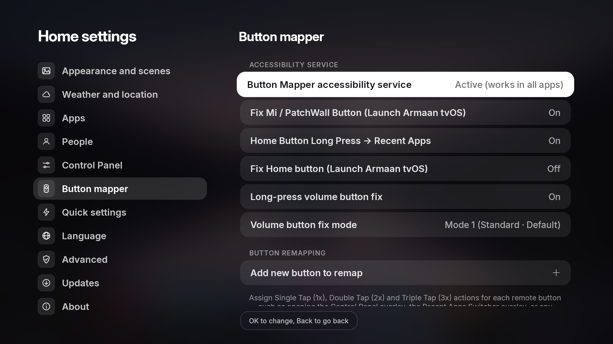
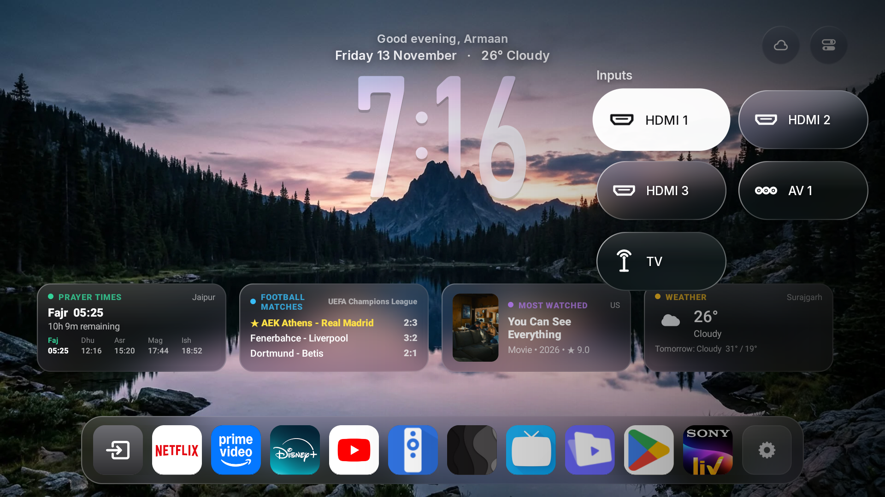

# Armaan tvOS (`v1.0.0`)

<p align="center">
  
</p>

<p align="center">
  <b>The Complete Apple tvOS Experience, Re-Engineered for Android TV & Google TV.</b><br>
  Built in pure native Java with zero runtime bloatware — buttery-smooth 60 FPS performance even on 1 GB RAM TVs.
</p>

<p align="center">
  <a href="https://github.com/Armaan0047/armaan-tvos/releases/latest"></a>
  
  
  
  
</p>

---

## ⚡ Highlights & Key Features

### 🪶 Tiny App. Tiny Footprint.
- **Ultra-Low Memory Consumption**: Consumes only **~42 MB RAM** on 1 GB Android TV devices, and **~85 MB RAM** on 2 GB Google TV devices.
- **Zero Heavy Runtimes**: 100% native Java architecture without Kotlin overhead, Jetpack Compose, or bulky webview engines.
- **Silky 60 FPS Navigation**: Layouts and glass graphics are drawn on-the-fly and let go immediately when an app launches, keeping memory free for your streaming video playback.

---

### 🔮 Liquid Glass & Frosted Glass Shaders
- **Dual Glass Styles**: Choose between high-refraction **Liquid Glass** (modern tvOS styling) or a soft, diffused **Frosted Glass** blur.
- **Customizable Blur**: Adjust blur radius directly in Settings to tailor visual depth to your TV's GPU capability.
- **Automatic Dark Mode**: Automatically transitions between light and dark glass at sunset or on a custom schedule, featuring authentic iOS-style dark app icons.

<p align="center">
  
</p>

---

### 💊 Glass Status Pills, Your Way
Personalize the top floating glass pill to match your needs:
- **Minimal**: Crisp display of the current time and active user profile.
- **Weather**: Current temperature and atmospheric conditions.
- **Full Status Bar**: Comprehensive pill displaying the time, day/night indicator, weather, Wi-Fi status, Bluetooth connection, microphone search, and Settings shortcut.

---

### 📂 Folders, Favorites & Centered Dock
- **Dynamic Squircle Dock**: Apple-style centered app dock with fluid focus magnification and subtle reflective highlights.
- **App Folders**: Group applications into clean categories (Streaming, Gaming, Utilities) that open on an authentic frosted glass modal.
- **Quick Favorites**: Easily organize and reorder your favorite streaming services.

---

### 📺 Continue Watching & Full-Screen Backdrops
- **Universal Watch Next**: Aggregates episodes and movies from YouTube, SmartTube, Netflix, Prime Video, Disney+, Apple TV+, Tivimate, Stremio, and Nuvio.
- **Swipe-Up Backdrops**: Focused apps display dynamic artwork; simply swipe up on your remote to transition into a full-screen backdrop view.
- **Direct Deep Links**: Jump straight into your next episode with a single click.

---

### 🔄 Recent Apps Switcher + Live RAM & Storage Hub
An authentic tvOS multitasking card switcher built right into your TV:
- **Large Preview Cards**: Seamlessly toggle between recently opened applications.
- **Live Hardware Telemetry**: Dual real-time liquid glass meters showing active RAM and Internal Flash Storage usage.
- **D-pad Up to Kill**: Highlight any running app card and swipe Up on your remote to dismiss the card and cleanly terminate the background process.
- **Close All Apps**: Fast batch closure with a staggered card animation.
- **System Protection Whitelist**: Safeguards critical system services (SystemUI, Bluetooth remote daemons, keyboards, HDMI managers) from accidental termination.

<p align="center">
  
</p>

---

### 🎛️ Glass Control Center Overlay
One press away, anytime, anywhere:
- Accessible over the home screen or **over any running app** without stopping video playback.
- **Quick Controls**: Sleep / Power Off timer, Wi-Fi status & setup, Bluetooth devices, HDMI Inputs switcher, AirPlay/Cast monitor, Dark Mode toggle, and System Settings.

<p align="center">
  
</p>

---

### 🎮 Remote Button Remapper & Hardware Input Fixes
- **Xiaomi Mi / PatchWall Button Fix**: Intercepts `KEYCODE_BUTTON_5` (192) and `KEYCODE_PROG_RED` (183). Permanently prevents the TV from unexpectedly switching to HDMI 3, opening Armaan tvOS Home screen instead.
- **Home Button Long-Press (500 ms)**: Holding the Home button opens the Recent Apps switcher; a single tap returns to the Home screen.
- **D-Pad Burst Debouncer**: Hardware input filter ignoring spurious rapid repeat packets (<65 ms) caused by Bluetooth interference, eliminating stuck navigation and input lag.
- **Color Button Remapping**: Assign actions or apps to Red, Green, Yellow, Blue, Menu, Guide, and Info remote buttons.

<p align="center">
  
</p>

---

### 🔌 Standalone TV Inputs Switcher
- Switch between **HDMI 1**, **HDMI 2**, **HDMI 3**, and **AV** inputs through an elegant glass overlay.
- Works even when the stock manufacturer launcher has been completely disabled or debloated.

<p align="center">
  
</p>

---

## 🚀 Quick Installation

### Method 1: 1-Click Automated Installer (Windows)
1. Enable **Developer Options** & **USB Debugging** on your Android TV.
2. Run `scripts/install.bat` and enter your TV's IP address.
3. Accept the debugging prompt on your TV screen. The script will handle installation, permissions, and default home setup automatically.

### Method 2: Manual ADB Commands
```bash
# 1. Connect to your TV
adb connect <YOUR_TV_IP>:5555

# 2. Install Release APK
adb install -r -g build/armaan-tvos-release.apk

# 3. Grant Accessibility Service (Button Mapper & Control Center)
adb shell settings put secure enabled_accessibility_services com.techgenius.tvoslauncher/.PowerService
adb shell settings put secure accessibility_enabled 1

# 4. Apply Xiaomi Mi Button Fix (if using a Xiaomi TV)
adb shell pm disable-user --user 0 com.xiaomi.android.tvsetup.partnercustomizer

# 5. Set Armaan tvOS as Default Home Launcher
adb shell cmd package set-home-activity com.techgenius.tvoslauncher/.MainActivity
adb shell am start -n com.techgenius.tvoslauncher/.MainActivity
```

For detailed guides, USB sideloading, or uninstallation instructions, see **[INSTALLATION.md](INSTALLATION.md)** and **[RESTORE_GUIDE.md](RESTORE_GUIDE.md)**.

---

## 📺 Device Compatibility

Armaan tvOS is universally compatible with devices running **Android TV 9.0 through Android 14+**:
- **Xiaomi Smart TVs**: MiTV-AXSO2 (dangalUHD), Mi Box 4K, Mi TV Stick
- **Google TV & Android TV**: Chromecast with Google TV, TCL, Philips, Sony Bravia, NVIDIA Shield TV
- **Fire TV Devices**: Fire TV Stick 4K / Max / Cube
- **Budget TV Boxes & Projectors**: Onn 4K Box, Allwinner/Rockchip Android projectors

See **[DEVICE_COMPATIBILITY.md](DEVICE_COMPATIBILITY.md)** for detailed hardware and chipset specifications.

---

## 🛠️ Building from Source

### Prerequisites
- JDK 17 or higher
- Android SDK Build-Tools 34.0.0+

```powershell
# Build signed production release APK (Windows)
.\build.ps1 -Release

# Output: build\armaan-tvos-release.apk (Signed with APK Signature Scheme v2 & v3)
```

---

## ⚖️ License & Attribution

Armaan tvOS is open source software licensed under the **[Apache License 2.0](LICENSE)**.

### Credits & Acknowledgments
- **Upstream Project**: Derived from and inspired by [tvOS-Launcher](https://github.com/techgenius1/tvOS-Launcher) by **techgenius (Siddhant)** under Apache-2.0.
- **Inter Typeface**: Designed by Rasmus Andersson — SIL Open Font License 1.1.
- **QR Code Generator Library**: Copyright (c) Project Nayuki — MIT License.
- **Inspirations**: Hume Launcher, Couch TV, CleanYourTV.

Full legal attribution and third-party notices are detailed in **[NOTICE](NOTICE)**.
